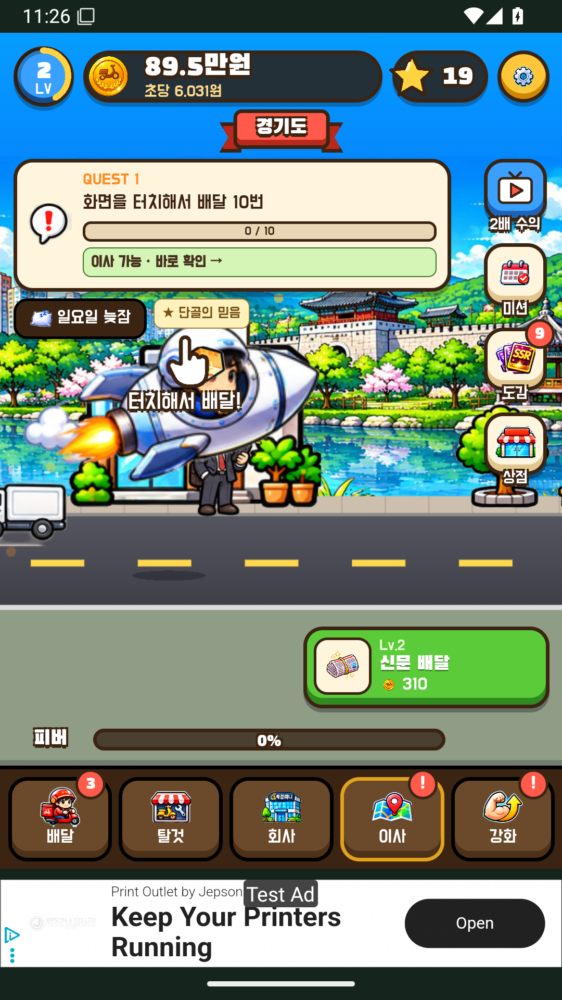

# 전체 테스트 광고 연결 — 1.0.11

## 적용

기존 보상형 광고 연결을 유지하고 배너, 앱 시작 전용(App Open), 전면(Interstitial) 광고를 추가했다. 네 형식 모두 구글 공식 테스트 광고 단위를 사용한다. 패키지·서명·게임 저장 키와 보유 혜택은 유지한다. 버전 코드 13 / 1.0.11-ads-test.

| 형식 | 표시 위치와 동작 |
| --- | --- |
| 보상형 | 기존 수익·룰렛·시간 워프·피버·명성·이벤트·이사·오프라인 보상 버튼. SDK 보상 완료 시에만 지급 |
| 배너 | 게임 아래 별도의 네이티브 영역. 로드 성공 시에만 공간을 열며 하단 메뉴를 덮지 않음. 회전 시 크기 재계산 |
| 앱 시작 | 돌아온 이용자의 로딩 화면에서 실행당 1회 시도. 미리 준비된 광고가 없으면 즉시 진행하며 늦게 뜨지 않음. 첫 사용 안내에서는 생략 |
| 전면 | 지역 이동 완료 후 도착 안내 전의 전환 구간. 시작 90초 동안 생략, 다른 전체 화면 광고 종료 후 최소 5분, 실행당 최대 2회. 준비 안 됐으면 즉시 진행 |

배너와 게임 사이에는 간격을 둔다. 보상형·앱 시작·전면 광고가 공유하는 네이티브 잠금으로 중복 표시를 막고, 닫힌 뒤에만 잠금을 해제한다. 보상형 광고가 보상을 일찍 알리더라도 실제 광고가 닫힐 때까지 자리를 점유한다. 전체 화면 광고 중에는 돌발 이벤트 시계를 정지한다.

## 설정 화면의 점검 도구

테스트 빌드의 설정 화면에 배너 다시 준비 / 앱 시작 / 전면 / 보상형 버튼과 로딩 상태를 추가했다. 수동 점검 버튼은 자동 표시의 빈도 제한을 우회하지만 중복 표시 잠금은 유지한다. 보상형 점검 버튼은 게임 보상을 지급하지 않는다.

‘배너·자동 광고’와 ‘프리미엄에서도 테스트 광고 표시’는 기기 내 별도 환경 설정이다. 초기값은 켜짐이며, 프리미엄·구매·진행 저장 기록은 변경하지 않는다. 프리미엄 테스트 표시를 끄면 기존 광고 제거 동작으로 돌아간다. 이 강제 표시는 테스트 빌드에서만 가능하다.

새 배너·앱 시작·전면의 실광고 단위는 비워 두었고, 실광고 빌드에서 새 형식은 비활성화한다. 운영 광고로 전환하려면 실제 단위와 동의 흐름을 별도 검수해야 한다. 이 작업에서 Play 업로드·출시는 수행하지 않는다.

## 검사 범위

기존 회귀 검사에 광고 연결 토큰·중복 콜백·동시 요청·테스트 전용 강제 표시·프리미엄 기록 보존 검사를 추가했다. 네이티브 광고 잠금과 종료 후 간격은 Java 단위 검사로 확인한다. Android WebView에는 실제 설정 버튼, 비활성화 시 즉시 복귀, 광고 영역의 메뉴 비중첩 검사를 추가했다. 네트워크와 독립적인 배치 검사는 배너 크기의 별도 시험 뷰를 사용한다.

Android 실행의 마지막에는 실제 SDK로 배너·앱 시작·전면을 로드하는 진단을 수행하며 성공 여부를 별도 기록한다. 광고 네트워크의 응답 실패를 게임 회귀 검사 성공으로 바꿔 주장하지 않는다. 실제 전체 화면 노출·닫기와 개인 휴대폰 네트워크는 추가 실기기 확인 대상이다.

## 공식 문서

- https://developers.google.com/admob/android/test-ads
- https://developers.google.com/admob/android/banner
- https://developers.google.com/admob/android/app-open
- https://developers.google.com/admob/android/interstitial
- https://support.google.com/admob/answer/6201362

## 최종 검증 결과

소스 `df853d2f393d225fa0c1048feca22fb4074ff663`의 [Actions 실행 43708473536](https://github.com/P1024P535/baedalwang-game/actions/runs/43708473536)에서 build·layout 모두 성공했다. Android WebView 검사 `OK (4 tests)`, 게임·광고·계정·랭킹 회귀 검사, Java 단위 검사와 화면·언어 232개 검사(오류 0건)를 통과했다. APK/AAB 에셋 일치 및 내려받은 파일의 SHA-256을 CI 기록과 대조했다.

실제 SDK 네트워크 진단에서 에뮬레이터 화면에 `Test Ad` 배너가 표시되며 게임 하단 메뉴 아래에 별도 공간을 차지하는 것을 스크린샷으로 확인했다. 앱 시작·전면 광고의 실제 전체 화면 표시와 닫기, 보상형 영상 재생은 이 스크린샷으로 확인한 것이 아니다. 설정 점검 버튼으로 실기기 검수가 남아 있다.

- APK SHA-256: `9c447de818010f4cf1fc53bcaf0e875491bd2f175e5affafeac1a82d2ff48c61`
- AAB SHA-256: `88c0e18991ce03b165680718453c38a5e9630e5d884eb670788d67c492549676`

