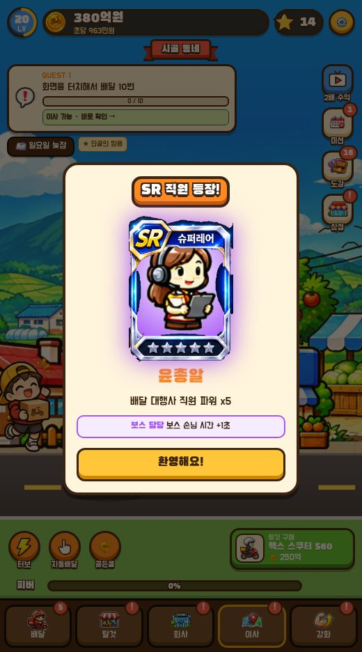

# 직원 카드 크기 수정 — 1.0.9

사용자 화면에서 SR 직원 등장 시 캐릭터와 배경이 테두리 아래로 튀어나왔다. 원인은 일반 팝업 아이콘용 `#mbox .mic img { max-height:140px }`가 높이 208px 직원 카드의 테두리에도 적용되었기 때문이다. 캐릭터·배경과 테두리의 높이 기준이 달라졌다.

## 수정

- 카드 내부 이미지는 일반 팝업의 최대 높이 제한에서 제외한다.
- 캐릭터·테두리는 하나의 카드 컨테이너를 기준으로 배치한다.
- 카드 비율을 SR 원본의 242:337로 유지하고, 테두리는 `contain`으로 표시한다. SSR 원본(242:339)도 비율을 유지한다.
- 작은 화면은 너비 110~150px, 낮은 가로 화면은 100px로 조정한다.
- 보상·확률·캐릭터 원본·저장 데이터는 변경하지 않는다.
- Android 버전 코드 11 / 1.0.9-ads-test. 공식 테스트 광고를 유지하며 Play 출시는 수행하지 않는다.

## 검사

기존 레이아웃 검사에 실제 직원 이미지(st_1 / st_0)를 쓰는 SR·SSR 등장 화면을 추가했다. 테두리와 카드의 크기 일치, 캐릭터의 카드 밖 돌출, 이미지 비율, 팝업과 확인 버튼 접근성을 8개 화면 크기에서 검사한다. 일반 팝업 회귀 검사도 유지한다.

로컬 화면에서 SR 직원 그림 전체가 테두리 안에 들어가며, 이름·특성·환영 버튼이 겹치지 않는 것을 확인했다. 화면은 별도 검수 데이터이며 배포 파일에 포함하지 않는다.

## 최종 검증

소스 `fe9b6e79e56e1c0027ef446e280c71c3a4622369`의 [검증 실행 43704013701](https://github.com/P1024P535/baedalwang-game/actions/runs/43704013701)에서 build와 layout 모두 성공했다. 개선 후 185개 화면·언어 검사에서 오류 0건이며, 이 중 SR·SSR 2종 × 8개 화면 크기를 확인했다. Android WebView의 게임 규칙·저장·반응형 3개 검사도 통과했다. 원본 파일 무결성, 광고·계정·랭킹 회귀 검사와 서명·패키지·APK/AAB 에셋 일치 검사도 유지했다.
