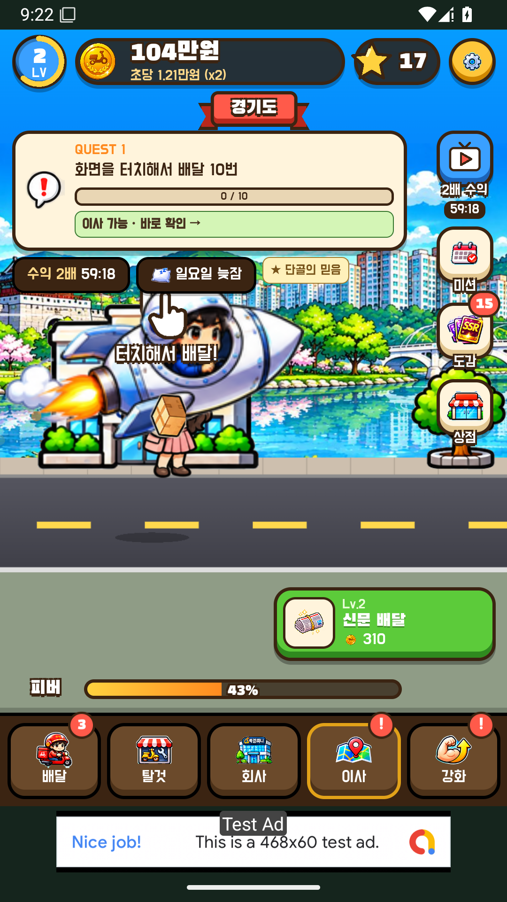

# 배너 표시 시 화면 공간 보완 — 1.0.13

사용자는 광고가 있을 때 게임 화면이 작아지고 상단의 빈 공간이 큰 현상을 제보했다. 레벨·돈·명성·설정·지역·퀘스트를 위로 정리하고, 확인이 끝난 광고 점검 메뉴 제거를 요청했다.

## 변경

- Android 네이티브 루트가 이미 상태 표시줄·노치·하단 제스처 영역을 제외하므로, WebView 내부에서 그 여백을 중복 가산하지 않는다. 브라우저 화면의 CSS 안전 여백은 유지한다.
- 상단 HUD 내부 여백 10→4px, 지역 리본 56→50px, 퀘스트와 우측 메뉴 92→82px로 올렸다. 중복 안전 여백 제거 효과는 기기 환경에 따라 추가로 적용된다.
- 배너를 고정 320×50dp 테스트 광고로 바꾸고 게임과의 간격은 4dp로 줄였다. 화면 위에 겹치지 않고 아래 공간을 별도로 쓴다. 폭이 320dp보다 작은 창에서는 잘린 배너를 노출하지 않는다.
- 배너가 예약한 높이를 네이티브에서 게임에 전달해 라이더 배율을 계산할 때 보정한다. 광고 전후 같은 창 폭에서 라이더 그림까지 함께 작아지는 현상을 방지한다. 실제 게임 세로 공간은 배너 높이만큼 줄며 화면을 광고 아래로 숨기지 않는다.
- 설정의 임시 광고 점검 패널·수동 광고 버튼·테스트 토글을 제거했다. 광고 SDK와 보상형·앱 시작·전면 연결은 유지한다. 구버전 임시 광고 OFF 설정으로 광고가 계속 꺼져 있지 않도록 새 기기 설정 기본값을 사용한다. 테스트 광고 강제 표시와 구매 혜택의 보유 기록은 분리한다.
- 기존 이야기·기념품·저장·성장 수치는 유지한다. versionCode 15 / 1.0.13-ads-test. 실광고 및 Play 출시는 수행하지 않는다.

## 검증 범위

실제 생성된 resize 함수로 4가지 화면 크기의 배너 전후 라이더 배율 일치를 검사한다. Android 검사에는 상단 중복 여백 제거와 임시 메뉴 제거를 확인하고, SDK 배너가 로드되면 표시 전후 배율과 55dp 이하 높이를 추가 확인한다. 광고 공간과 게임 메뉴의 비중첩, 기존 10개 화면 크기·이야기·카드·보상·저장 회귀 검사도 유지한다.

## 최종 검증 결과

소스 `122e70c71c24cdf7fe09cf3488c80cf2f7e62916`의 [Actions 실행 43762583941](https://github.com/P1024P535/baedalwang-game/actions/runs/43762583941)에서 build·layout 모두 성공했다. Android WebView `OK (5 tests)`, 배너 전후 배율 회귀 검사, 기존 게임·광고·계정·랭킹·인연 검사, Java 단위 검사와 252개 화면·언어 검사(10개 화면 크기, 오류 0건)를 통과했다. 실제 SDK 테스트 배너가 보이는 스크린샷을 확인했으며, 로드 성공 시의 높이 55dp 이하·라이더 배율 유지 검사도 통과했다. dp와 CSS 정수 픽셀의 반올림 오차는 배율 0.005 이내로 허용한다.

APK/AAB 에셋과 생성 소스의 일치, 서명·버전 및 다운로드 후 SHA-256 대조를 완료했다.

- APK SHA-256: `70619e15c24591fded98cc71473156af3f58d46fbc5a89364d89e7942e3796d8`
- AAB SHA-256: `ef0ccb4522bb979ac62fd9343ba3bf8986d46babe3a9bf8c5cfe0232c7c3ad93`

