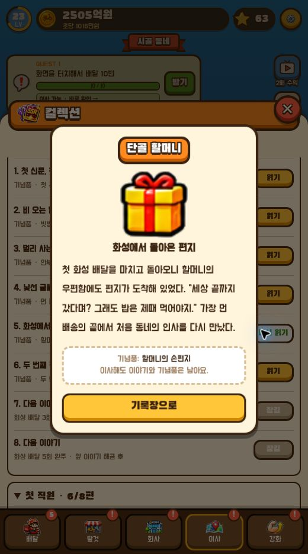

# 배달왕 인연·기념품 추가 — 1.0.12

기존 배달→강화→탈것→회사→이사→다음 회차 흐름에 선택적인 이야기와 영구 수집 기록을 연결했다. 기존 수익 공식·가격·보상·해금 조건은 변경하지 않는다. 새 이야기를 읽거나 기념품을 골라야 지역을 옮길 수 있는 구조도 아니다.

## 콘텐츠

- 단골 할머니·첫 직원·번개맨 각 8편, 총 24편의 짧은 이야기를 추가했다.
- 각 인물은 기존 플레이 조건으로 4편을 열고, 첫 화성 완주와 2·3·5회 완주 후 후일담을 연다. 앞 이야기의 해금이 필요하지만 읽기는 필수가 아니다.
- 할머니는 첫 신문 인사에서 가족의 안부와 화성 답장으로, 직원은 첫 출근에서 회사의 공동 기억으로, 번개맨은 경쟁에서 동행과 재대결 약속으로 이어진다.
- 직원 도감 8종에 최초 획득 시 등록되는 인물 소개를 붙였다. 현재 직원 수·파워와 분리된 인연 기록이며 이사해도 유지된다.
- 이야기 1편당 기념품 기록 1개가 자동으로 모인다(총 24개). 대표 기념품을 선택하면 회사 화면에 이름이 전시된다. 별도 이미지 장식 배치나 수익 배수는 추가하지 않았다.

| 인물 | 초반 네 편의 순차 조건 | 후반 네 편 |
| --- | --- | --- |
| 할머니 | 배달 10번 → 면소재지 → 경기도 → 아시아 | 첫·2·3·5회 화성 완주 |
| 첫 직원 | 직원 누적 1명 → 10명 → 광역시 → 지구 | 첫·2·3·5회 화성 완주 |
| 번개맨 | 배달 30번 → 레이스 1승 → 3승 → 5승 | 첫·2·3·5회 화성 완주 |

레이스는 기존 레이스이며 새 전투·별도 조작은 없다. 친밀도 소모·하락, 선물 결제, 추가 광고 조건, 별도 특별 주문 숙제는 도입하지 않았다. 인연의 진행은 이야기 해금 편수로 표시한다.

## 화면과 저장

기존 컬렉션에 ‘인연’ 탭을 추가하고 도감 첫 화면에 바로가기를 배치했다. 이야기·직원 인연·기념품은 접어서 볼 수 있다. 읽지 않은 이야기와 직원 소개만 새 기록 숫자에 더하며, 읽으면 해당 숫자가 줄어든다. 기념품은 자동 수집이라 별도의 수령 알림을 만들지 않는다.

조건 달성 시 짧은 도감 안내만 주고, 이야기 창을 강제로 띄우지 않는다. 기존 이용자의 누적 배달·고용·레이스·직원 도감과 최고 지역으로 이전 진행을 반영하며, 최초 이관 때 알림을 몰아서 띄우지 않는다. 인연·읽음·직원 소개·대표 기념품을 저장하고 실제 지역 초기화의 보존 목록에도 포함했다.

패키지·서명·저장 키 `baedal_king_v1`·저장 버전 2 유지. Android versionCode 14 / 1.0.12-ads-test. 테스트 광고 연결을 유지하며 Play 출시는 수행하지 않는다.

## 검증

Node 검사는 단계별 해금, 잠긴 기록 접근 방지, 반복 읽기의 중복 처리, 기존 저장의 조용한 이관, 24편·직원 8종, 읽음 숫자, 재화 변화 없음, 저장 후 복원과 수집 유지에 집중한다. Android에는 기존 검사를 유지하며 실제 이사 처리 후 인연·읽음·기념품 보존 검사를 추가했다. 화면 검사에는 인연 목록과 긴 이야기 팝업을 작은 화면·가로 화면에도 포함했다.

로컬 화면 검수는 별도 시험 기록을 사용하며 배포 파일에는 그 기록을 포함하지 않는다. 실제 장기 재방문 효과를 입증한 결과는 아니다.

추가 이야기 본문은 한국어 기준이다. 다른 언어의 전체 번역과 실제 이용자 재방문 효과는 이번 검증 범위에 포함하지 않는다.

## 최종 검증 결과

소스 `3e8dde7cb6fae32ae89259594637cc749e29fa6f`의 [검증 실행 43730395879](https://github.com/P1024P535/baedalwang-game/actions/runs/43730395879)에서 build·layout 모두 성공했다. Android WebView `OK (5 tests)`, 기존 게임·광고·계정·랭킹 및 새 인연 회귀 검사, Java 단위 검사를 통과했다. 인연 목록·이야기 창을 포함한 개선 후 252개 화면·언어 검사에서 오류가 없었다(10개 화면 크기). APK/AAB 내부 에셋 일치 검사와 내려받은 결과물의 해시 대조도 완료했다.

- APK SHA-256: `d2d5b079eaaf7e58aeb0e94fe8e1e19afa06e5c7d089b7c014d0ae940b700385`
- AAB SHA-256: `1cca58bc1226642f0a45c879d0b479bef150b5aa8a960638155c09f9b94fe3f3`

