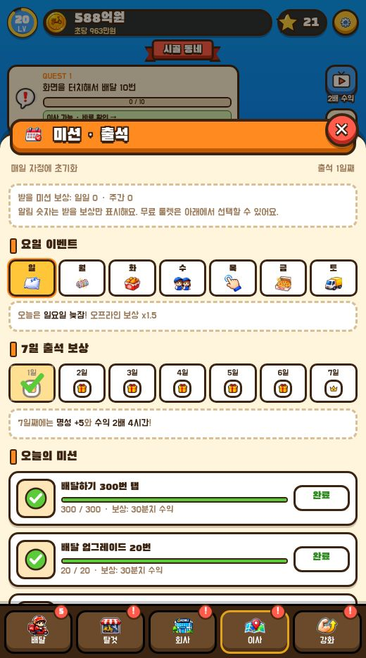

# 미션 알림 숫자 수정 — 1.0.10

사용자는 미션을 모두 수령해도 미션 아이콘에 1이 남는 현상을 제보했다. 기존 계산은 무료 룰렛 가능 여부를 1로 더했다. 주간 미션도 숫자에 더했지만 실제 화면은 상점 본문으로 덮어써져 보이지 않았고, 일일 대체 미션은 표시와 다른 원본 목표로 집계했다.

## 수정

- 미션 알림은 화면에 표시되는 일일·주간의 수령 가능한 보상만 센다. 무료 룰렛 가능 여부는 제외한다.
- 일일 미션 목록과 알림 모두 대체 목표·진행률을 동일하게 사용한다.
- 모든 개별 보상을 받으면 전부 완료 보상이 1로 표시되고, 그것까지 받으면 사라진다.
- 주간 미션을 일일 미션 아래에 표시한다. 알림에 주간 보상이 잡히면 같은 화면에서 받을 수 있다.
- 화면 위에 일일·주간 수령 가능 개수를 안내한다. 무료 룰렛은 화면 아래에서 계속 이용할 수 있다.
- 날짜 초기화, 기존 수령 기록·보상·저장 키를 유지한다. 버전 코드 12 / 1.0.10-ads-test.

## 검사

Node 회귀 검사에서 미사용 무료 룰렛, 일일 올클리어 보상, 광고 대신 배달 완료, 주간 보상 수령, 날짜 변경을 검사했다. Android WebView 검사에도 ‘전체 수령 후 무료 룰렛이 남아 있어도 알림 없음’과 ‘주간 알림에 대응하는 실제 버튼을 눌러 수령 후 알림 해제’를 추가했다.

로컬 검수 데이터로 일일 보상 수령 후 받을 보상이 일일 0·주간 0이며 메인 미션 아이콘에 숫자가 없는 상태를 확인했다. 검수 데이터는 배포 파일에 포함하지 않는다.

## 최종 검증

소스 `1966d2e8b181c2d45a7fea197ced29e5503f6e88`의 [검증 실행 43705237115](https://github.com/P1024P535/baedalwang-game/actions/runs/43705237115)에서 build·layout 모두 성공했다. Android WebView 3개 검사와 기존 게임·광고·계정·랭킹 회귀 검사를 통과했다. 개선 후 화면·언어 185개 검사에서 오류가 없었으며, 8개 화면 크기와 SR·SSR 카드 회귀 검사도 유지했다. 공식 테스트 광고 버전이며 Play 업로드·출시는 수행하지 않았다.
