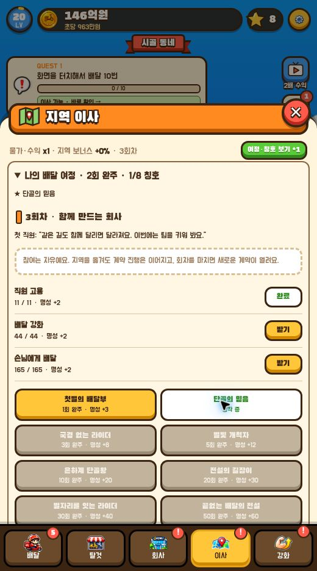

# 배달왕 1.0.8 장기 플레이 보완

목표는 첫 엔딩 이후에도 새로운 계약·칭호를 얻고, 쉬는 동안 보유금을 잃지 않으며, 광고 없이도 일일 목표를 채울 수 있게 하는 것이다. 실제 이용자 재방문율을 이미 입증한 변경은 아니다.

## 반영 내용

1. 보스·펑크·공사 실패 시 보유금 차감을 제거했다. 참여하면 추가 보상을 얻고, 놓쳐도 저장된 돈은 유지된다. 참여 안내 문구도 수정했다.
2. 회차 목표 배수를 `3^클리어수`에서 `2^min(클리어수,5) × (1 + 0.2 × max(0,클리어수−5))`로 완화했다. 첫 회차 목표는 유지하고, 6회차 이후 목표 증가가 계속 지수적으로 커지지 않게 했다. 회차 수익 보너스는 기존 `1 + 클리어수`를 유지한다. 이미 쌓인 돈·누적 수익은 줄이지 않는다.
3. 일일 광고 보상 미션에 배달 대체 경로를 추가했다. 광고 1회 또는 배달 50회가 1단계이며 2단계 완료 시 기존 보상을 받는다. 광고 없이 배달 100회로도 완료된다. 실제 광고 보상 횟수와 일일 상한은 별도로 유지된다.
4. 주간 이사 미션은 이사 2회 또는 지역 목표 합계 20% 진행으로 완료된다. 지역 이동에 따른 진행률 초기화가 불이익이 되지 않도록 누적 이동과 지역 진행을 연결했다. 기존 수령 기록은 보존하고, 새 대체 경로는 적용 시점부터 집계한다.
5. 첫 화성 배달 이후 회차별 여정 계약을 추가했다. ‘단골의 부탁’·‘함께 만드는 회사’·‘번개맨의 도전장’이 순환하며, 배달·강화·직원·돌발 상황·레이스를 서로 다르게 요구한다. 회차가 올라가면 목표가 조금 늘고 상한을 둔다. 계약은 선택 사항이며 엔딩 조건이 아니다.
6. 계약 1개당 명성 +2를 지급한다. 지역을 옮겨도 진행이 이어지고, 다음 회차에서 새 계약과 기준값으로 시작한다. 보상은 중복 지급되지 않는다.
7. 1·2·3·5·10·20·30·50회 완주 수집 칭호를 추가했다. 수령한 칭호는 장착할 수 있고 메인 효과 영역에 표시된다. 기존 의상과 결제 효과는 유지된다. 칭호 자체에 별도 수익 배수는 없다.
8. 이사 화면과 기록 화면에 ‘나의 배달 여정’ 보드를 추가했다. 첫 회차에서는 접어 두어 기본 조작 안내를 방해하지 않으며, 첫 엔딩 이후 계약과 수집 보상이 열린다.

## 저장과 배포

패키지명·서명·저장 키 `baedal_king_v1`·저장 버전 2를 유지한다. 선택적 `career` 기록과 강화 누적 통계를 추가한다. 원본 495개 파일을 보관하고, 기존 빌드 과정에서 승인된 수정 사항을 적용한다. Android 버전 코드 10 / `1.0.8-ads-test`.

공식 테스트 광고와 기존 결제 준비 중 상태를 유지한다. 이 작업은 수정·검증·테스트 파일 준비이며 Play 배포는 수행하지 않는다.

## 검사

목표 배수의 증가 상한, 실패 시 보유금 보존, 광고 없는 일일 완료, 주간 진행률과 기록 이관, 계약의 지역 이동·회차 전환·저장, 칭호 소유·장착·중복 지급 방지를 검사한다. 기존 룰렛·광고·계정·랭킹 방어 검사도 유지한다.

추가 계약과 칭호는 한국어 기준으로 구성했다. 실제 휴대폰 광고 영상·Google 계정 복원과 실제 이용자 장기 재방문은 별도 확인이 남아 있다.

## 90일 경제 시나리오 비교

| 광고·결제 없는 접속 조건 | 기존 완주 수 | 변경 후 완주 수 | 변경 후 첫 완주 |
| --- | ---: | ---: | ---: |
| 하루 30분 1회, 초당 터치 1회 | 5 | 7 | 약 10일 |
| 하루 15분씩 4회, 초당 터치 2회 | 6 | 17 | 약 4일 |

변경 후 하루 1시간 조건은 후반에도 대체로 4~6일 간격으로 다음 회차를 완료한다. 하루 30분 조건에서는 약 8~15일 간격이다. 이는 효율적으로 강화·이사·보상 수령을 수행하는 경제 모형이며 실제 재방문율이나 플레이 기간 보장이 아니다. 시드 1개를 사용했고 돌발 상황 대응은 근사했다. 선택 계약·칭호·챕터 보너스 및 새 주간 대체 경로는 모형에서 제외했다. 조건과 결과는 `analysis/20261115/retention-comparison-1.0.8.json`에 기록했다.

## 화면 검수

별도 로컬 검수 데이터로 3회차 계약 수령과 칭호 장착을 확인했다. 수령한 계약이 완료로 바뀌고, 칭호가 장착 중으로 표시되며, 화면이 위로 튀지 않고 여정 보드 위치가 유지된다. 검수 데이터는 배포 파일에 포함하지 않는다.

## 최종 검증 결과

소스 `fe30b3e7c287417bdac670fdda3e5c97981ee833`의 [Actions 실행 43702366503](https://github.com/P1024P535/baedalwang-game/actions/runs/43702366503)에서 build·layout 모두 성공했다. 원본 무결성, 게임·광고·계정·랭킹 회귀 검사, Java 단위 검사, Android WebView 동작·저장·반응형 3개 검사(`OK (3 tests)`), 8개 화면 크기 레이아웃 검사를 통과했다. APK/AAB 내부 에셋이 생성된 개선 소스와 동일한지 검사했고, 내려받은 결과물의 SHA-256도 CI 기록과 대조했다.

- APK SHA-256: `cbc858a589e390518aa98ddd0ead2ec16fec599acb5af5076d4ab36a946cfc76`
- AAB SHA-256: `2bb17cab878c45d9fa544f1fddf6f64099e48faf7d731742c9ec21344b350361`

실제 휴대폰에서의 광고·계정 복원과 이용자 재방문 성과는 미확인이다. Play 업로드·출시는 수행하지 않았다.
